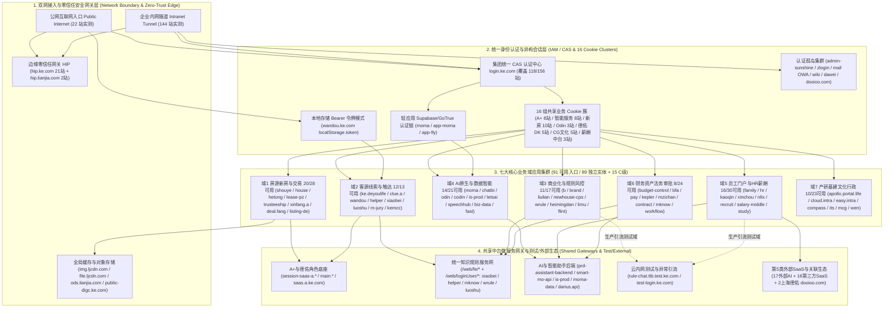
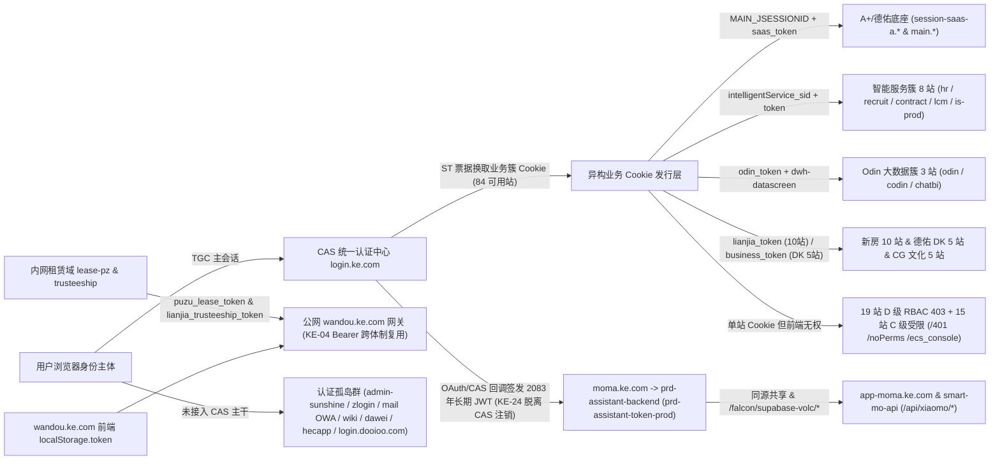
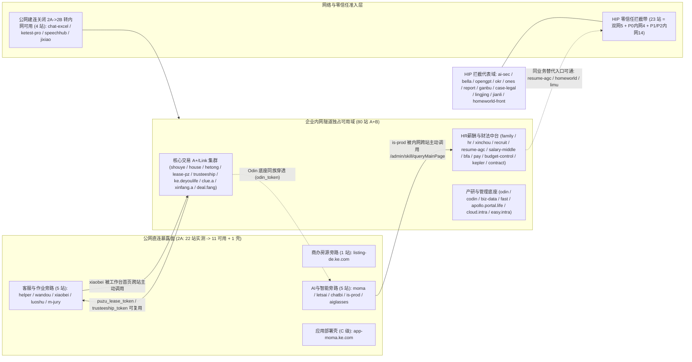
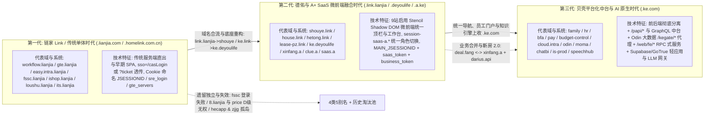

# 目标企业全生态企业信息系统架构全景报告

> **重要范围声明**：本文梳理、综合并论证的是**目标企业全生态企业信息系统架构（Target Enterprise Ecosystem Architecture Panorama）**，**并非 `BeikeMicroservice` 项目本身的软件工程架构**。本文全部事实严格来源于纯离线实测数据集 [final_ecosystem_dataset.json](./final_ecosystem_dataset.json)（汇聚 156 个独立深扫主机、17 个 P1/P2 快筛淘汰主机、15 个历史 `not_counted` 站点、30 个基础支撑与隐性后端域、5 个别名入口、35 个外部 SaaS 与上海德佑关联域，以及只读安全审计基线 [kecom-security-audit-report-2026-11-20.md](../kecom-security-audit-2026-11-20/kecom-security-audit-report-2026-11-20.md)）。

---

## 1. 全量实测定量基线与结构分布

在深入架构视图之前，首先锚定本生态观测所得的精确量化规模：
- **全域映射总量**：Phase 1 枢纽导航抽取与差异聚类共识别 **173** 个进入 Phase 2 评估的内部 Web 候选入口 + **5** 个显式别名 + **12** 个未重测历史项 + **30** 个核心后端/基础域 + **35** 个外部第三方/关联域。
- **独立深扫与可用结构**：173 个候选经 17 站轻量快筛淘汰后，**156 个独立主机**完成完整浏览器渲染与 XHR 核验，结果为 **91 站实质可用（38 A + 53 B，占比 `58.3%`；去重重定向合并后为 89 个独立业务系统实体）**、**15 站 C 级部分受限或空壳**（`9.6%`）、**50 站不可用**（D 级业务 RBAC 19 + E 级 HIP 安全网关拦截 23 + F 级独立认证 3 + G 级错误/不可达 5）。
- **双网边界不对称性**：在 **22** 个不经 VPN/内网隧道的公网直连深扫目标中，**11 站（50.0%）实质可用**（5 个原基线 + 6 个新确认 AI/客服/动态表单/纠纷系统）；而在内网隧道测试的 **144** 站中，贡献了 **80 个内网独有可用系统**，但仍有 **23 站**被边缘安全网关 `hip.ke.com` / `hip.lianjia.com` 直接阻断。
- **SSO 收敛与断层**：156 站中 **`cas_redirect`（`login.ke.com`）占 118 站（`75.6%`）**，在 91 个实质可用系统（A+B）中占比更达 **84 / 91（`92.3%`）**；但同时存在 `supabase_cas`（3 站）、`localstorage_bearer`（1 站）、完全免认证 `none`（6 站）、独立登录 `independent_login`（1 站，另加淘汰 7 站）等异构认证断层。

---

## 2. 全局四层企业系统架构全景图

以下架构图将全生态 156 个应用端节点、30 个底层 API/网关域及外部 SaaS 集群归纳为四个纵向层次：**双网接入与零信任安全边界层 → 统一身份认证与异构会话层 → 七大业务域应用集群 → 共享中台网关、数据底座与外部 SaaS 层**。

---

## 3. 统一身份认证（IAM / CAS）与跨系统会话流转图

目标企业的身份与访问控制体系呈现出 **“表层单点登录高度集中，底层会话载体与权限判定高度异构分散”** 的典型特征：
1. **CAS 主干通兑（118 站 / A+B 占 84 站）**：以 `login.ke.com` 的 TGC 会话为根凭证，各业务子系统通过 `/cas`、`/casLogin`、`/web/login/cas`、`/proxy4ke/login/cas` 等端点换取短期 ST 票据，进而签发 **16 个跨站共享业务 Cookie 簇**与几十种单站会话 Token（如 `budget_control`、`koin_token`、`pay_ke_token`、`jt_apollo_login_token` 等）。
2. **A+ 双重角色上下文底座**：`shouye`、`house`、`hetong`、`lease-pz`、`ke.deyoulife`、`clue.a` 在 CAS 之上再通过 `session-saas-a.*` 与 `main.*` 获取经纪人业务角色列表并支持不重新登录的跨门店/角色热切换。
3. **跨体系会话脱节与重用（`KE-04` 与 `KE-24`）**：
   - `moma.ke.com` 经 CAS 后换取 `prd-assistant-token-prod`（有效期达 `2083` 年）并接入 `app-moma` 的 Supabase/GoTrue 认证链，**CAS `/logout` 并不会吊销 Moma 主站或 Supabase 会话**；
   - `wandou.ke.com` 不使用 CAS 直跳，而是以 `localStorage.token` Bearer 形式向网关提交凭证，**历史实测确认同一网关同时接收普租 `puzu_lease_token` 与托管 `lianjia_trusteeship_token`**（跨业务线令牌互认）。
4. **认证孤岛与前端静默 RBAC 拒绝**：`admin-sunshine`、`zhidao`（`zlogin.ke.com`）、`mail`/`owa`、`wiki`、`dawei`、`hecapp` 与上海德佑 `login.dooioo.com` 脱离主 CAS；而另 **19 个 Grade D** 与部分 **Grade C** 系统虽然完成 CAS 登录并拿到业务 Cookie，仍在 SPA 启动阶段因 `/auth/roles`、`/permission/ids` 或 `/401` 判定业务无权。

---

## 4. 网络隔离与「系统旁路」外溢拓扑图

为什么在不接入企业内网 VPN 的纯粹公网环境下，依然存在可用的企业级内部系统？把 **22 站公网深扫** 与 **144 站内网隧道深扫** 放在同一坐标系下比对，可以清晰看到 **“边缘发布错位 + 共享后端穿透 + 选择性零信任策略”** 共同塑造了当前的旁路格局：
- **公网直连可用旁路（11 站 = 5 原基线 + 6 新增确认）**：主要集中在 **AI 原生/大模型（5 站：`moma`、`letsai`、`chatbi`、`is-prod`、`aiglasses`）**、**客服/知识/规则/纠纷表单（5 站：`wandou`、`helper`、`xiaobei`、`luoshu`、`m-jury`）** 以及 **商办新版（1 站：`listing-de`）**。另有 `app-moma.ke.com` 在公网可达但根路径落入 `deploy_404`（C 级）。
- **公私能力反哺与对称替代现象**：
  - `is-prod.ke.com`（智能服务）与 `xiaobei.ke.com`（小贝知道）**本身部署在公网直连边界**，同时作为共享能力服务被大量纯内网核心系统（`shouye`、`link`、`hr`、`recruit`、`contract`、`lcm` 等）跨站加载；
  - `chat-excel`、`ketest-pro`、`speechhub`、`jixiao` 4 站在公网仅暴露端口或静默重置建连（2A 阶段失败），一旦经内网隧道访问全部立即可用（B 级）；
  - `jianli.ke.com`（聘多多候选入口）在公网和内网均被 `hip.ke.com` 拦截，但同一业务的另一个内网域名 `resume-agc.ke.com` 却可以绕过 HIP 正常加载并访问简历/面试候选接口；类似地，`homeworld-front.ke.com` 被 HIP 拦截，而 `homeworld.ke.com` 在内网可用。
- **HIP 零信任网关的 23 站拦截边界**：所有 `hip.ke.com`（21 站）与 `hip.lianjia.com`（2 站）拦截**在双网测试下表现一致**（`ai-sec`、`bella`、`jianli`、`opengpt`、`app-fly` 无论公网还是内网均被拒），说明 HIP 触发机制并不仅依赖来源 IP，更依赖终端浏览器环境策略或零信任设备准入态。

---

## 5. 三代技术栈与品牌演进收敛图

从域名命名（`*.homelink.com.cn` → `*.lianjia.com` → `*.deyoulife.com` / `*.a.ke.com` → `*.ke.com`）、前端渲染技术（服务端 JSP/传统 MVC → React/Vue SPA → Stencil Shadow DOM 微前端）以及认证与 API 网关规范（`casLogin` / `/api/*` → `session-saas-a.*` → `/papi/*`、`POST /graphql`、`/web/fe/*`、Supabase/AI Gateway），清晰折射出目标企业 **三代信息系统的历史演进与当前并存收敛态**：

---

## 6. 深度架构洞察（基于 156 站全量实测特征提炼）

### 洞察一：三代并存下的域收敛规律与“单主体双栈保留”现象
全生态并非完成一次性技术替换，而是以 **“渐进重定向合流 + 统一顶栏聚合 + 多后缀同体共存”** 实现平滑演进：
1. **实证重定向合流**：旧链家入口已主动向新一代工作台与德佑体系收缩，例如 `ke.link.lianjia.com` 直接跳入 `ke.deyoulife.com`、`link.lianjia.com` 合流至 `shouye.link.lianjia.com`、`naturaloppty.ke.com` 合流至 `oomp.ke.com`、`bpm-m.ke.com` 合流至 `bpm.ke.com`；加上 Phase 1 确认的第 4 类 **5 个显式别名**（`elearning`→`study`、`fang.deyoulife`→`house.link`、`helper.lianjia`→`helper.ke`、`home.ehr.lianjia`→`family.ke`、`zhenzhu`→`listing-de`），新老域名通过 302 或网关路由持续收口。
2. **双域共存对照**：同一职能下常并存两套实现——如 IT 门户双域名 `its.ke.com` 与 `its.lianjia.com` 共享 `its_ke_token` 与完全相同的顶栏；费用报销体系则同时存在淘汰中的老费控 `fssc.lianjia.com`（F 级登录失败）、过渡态 `ecs_console` 平台 `finops.ke.com`/`rpm.ke.com`（C 级二次 SSO）以及新一代可用主体 `budget-control.ke.com` / `pay.ke.com` / `bfa.ke.com`；此外，**上海德佑系 `*.dooioo.com` 历史体系**保留了 `login.dooioo.com`（含 `jiaoyi`/`jinrong`/`shluyin` 等 9 个上海子域）和 `renzi.dooioo.com` 独立 CAS 圈层，在集团总主干之外保持区域性自治。

### 洞察二：16 组共享 Cookie 簇揭示跨业务线的“隐性平台家族”
通过聚合 156 站的真实响应 Cookie（剔除 `lianjia_ssid`/`secdn_server_bak`/`rememberMe` 等通用基础设施字段），系统间的真实平台血缘关系比一级域名更有说服力：
- **A+ 统一作业底座（8 站）**：以 `MAIN_JSESSIONID`、`_lianjia_link_snid`、`saas_token` 为纽带贯穿 `shouye`、`link`、`house`、`hetong`、`lease-pz`、`ke.deyoulife`、`ke.link`、`clue.a`，其中 `house` 与 `lease-pz` 额外共享 `HOUSEJSESSIONID` 与 `login_ucid`。
- **智能服务嵌入式家族（8 站）**：`is-prod.ke.com` 通过写入 `intelligentService_sid` 与 `intelligentservice_token`，横向嵌入 `hr`、`hrlearn`、`recruit`、`contract`、`cb`、`lcm`、`leader` 7 个看似互不相干的人资/合同/预实系统中。
- **业务与内容子生态簇**：**新房与工具链簇**（`lianjia_token` 横跨 10 站）、**德佑 DK 认证簇**（`business_token`/`ke_dk_u_*` 横跨 `ke.deyoulife`、`ke.link`、`limu`、`m-jury`、`resume-agc` 5 站）、**企业文化 CG 簇**（`cg_ke_com`/`mcg_ke_lianjia_token` 横跨 5 站）、**Odin 数据分析簇**（`odin_token`/`dwh-datascreen_token` 横跨 `odin`、`codin`、`chatbi` 3 站）、**薪酬中台簇**（`salary_middle_token` 串联 `salary-middle`、`salary-tax`、`cb`）、**学堂/校园簇**（`renovation-token` 与 `huaqiao_token` 各连 2 站）。这种高度耦合意味着共享域内的任意 Cookie 或子接口缺陷都具备跨应用横向移动影响。

### 洞察三：双网边界错位与“公网能力组件反哺内网”形成的旁路图谱
公网直连（11 站）与内网隧道（80 站独有）之间并非绝对的物理隔绝，而存在三条显著的边界穿透与旁路通路：
1. **公网直接暴露的高交互业务/AI 系统**：`moma.ke.com`、`wandou.ke.com`、`chatbi.ke.com`、`is-prod.ke.com`、`listing-de.ke.com`、`helper.ke.com`、`xiaobei.ke.com`、`luoshu.ke.com`、`m-jury.ke.com` 均在公网无需 VPN 即可完成完整员工认证与业务数据读写（外加免登录 `aiglasses.ke.com`）。
2. **内网工作台反向调用公网域**：实测捕获内网主工作台 `shouye.link.lianjia.com` 在加载时调用公网 `xiaobei.ke.com` 检查登录与知识配置；内网 `contract`、`recruit`、`lcm` 等系统则主动跨站调用公网 `is-prod.ke.com/admin/skill/queryMainPage`。
3. **同一能力的异域旁路替代**：`jianli.ke.com`、`homeworld-front.ke.com`、`lingjing.ke.com` 在前端入口均触发 `hip.ke.com/forbidden`，而相同功能线对应的 `resume-agc.ke.com`（聘多多候选列表）、`homeworld.ke.com`（行政服务）、`limu.ke.com`（立木设计）在内网通道均完整可用。

### 洞察四：HIP 零信任网关与业务 RBAC 构成双层拦截，“假通过”揭示 SPA 鉴权特征
在不可用与受限资产中，拦截机制呈现出清晰的分层结构：
- **第一层（L7/零信任边缘）— HIP 网关（23 站）**：涵盖 `ai-sec`、`bella`、`opengpt`、`okr`、`ones`、`report`、`legal-compliance`、`case-legal`、`company-legal`、`pan.fang`、`newcms.fang` 等高敏研发协同、法务诉讼、合规、干部画像与 AI 工具，在请求阶段统一由 `hip.ke.com`（21 站）或 `hip.lianjia.com`（2 站）阻断。
- **第二层（应用层）— 前端静默 RBAC 拒绝（19 站 D 级 + 15 站 C 级）**：绝大多数现代 React/Vue SPA 首包均返回 HTTP 200 HTML 骨架，直到浏览器执行 JS 并调用 `/api/*/auth/roles`、`/permission/ids`、`/getUserPerms` 或 `/api/manage/hasRole` 后，才渲染 `Forbidden` 卡片或跳转 `/403`、`/401`、`/noPerms`。这也是 Phase 2B-P1P2 中纯 HTTP 轻量快筛产生 **`43.1%`（31 / 72）硬假通过率**（若含 C 级共 `58.3%`）的根本架构原因。

### 洞察五：统一技术规范表象下的身份认证非均质断层
虽然全生态可用站中有 **`92.3%`（84 / 91）** 使用 `cas_redirect`，但底层架构在四个具体节点存在显著断层与安全耦合风险：
- **会话生命周期脱节（`KE-24`）**：`moma.ke.com` 与 `prd-assistant-backend.ke.com` 基于 CAS 换发长效 `prd-assistant-token-prod`（有效期至 2083 年），且 CAS 注销不会回收该业务 Token 及扩展域 `smart-mo-api.ke.com` 会话；
- **跨边界凭证混用（`KE-04`）**：`wandou.ke.com` 采用 `localStorage.token` Bearer 模式，且其网关同时把内网 `lease-pz` 与 `trusteeship` 的业务 Cookie 作为合法 Bearer 凭据，打通了内网租赁态 Cookie 与公网 IM 服务之间的凭证边界；
- **多租户轻应用同源共栖**：`app-moma.ke.com` 以同一 Origin 承载不同团队轻应用并共享 `localStorage` 及 `/falcon/supabase-volc/*` 网关，缺少租户级源隔离；
- **独立认证与过渡期阻塞**：尚存 **10 处**认证孤岛（3 站 F 级深扫 + 7 站快筛淘汰）各自维护独立账号或表单域，且 ActionSoft BPM（`bpm`）与 `ecs_console` 费控体系（`finops`/`rpm`）依赖复杂二级跳转签发签名串参数（`sign`、`timestamp`），在自动化会话条件下易发生超期或中断。

### 洞察六：实测捕获“生产引流测试域”等异常架构与治理盲区信号
对 156 站全量浏览器运行时网络请求（XHR/302）的抓取揭示了两项极具架构治理价值的直接实证异常，以及多处配置遗留特征：
1. **生产入口运行时请求测试环境接口（2 处实证）**：
   - 域 3 核心合规入口 **`heimingdan.lianjia.com`（A 级可用）** 在页面加载期间直接发起 `GET rule-chat.ttb.test.ke.com/api/chat/fixed_script`（返回 HTTP `302`），将生产流量指向历史审计中标记为 RFC 6598 CGNAT 内网测试集群的 `*.ttb.test.ke.com`；
   - 域 5 HR 业务页 **`hrlearn.ke.com`（D 级）** 在 CAS 登录后向测试认证域发起 `GET test-login.ke.com/authentication/sdk/init`（返回 HTTP `200`）。
2. **失效链路的跨系统残留调用**：已处于 E 级被 HIP 拦截的 `app-fly.ke.com` 在重定向之前仍在页面中请求 `app-moma.ke.com/falcon/supabase-volc/8badeffb-.../auth/v1/authorize`（`302`）与 `ai-security-data.ke.com/api/v1/collect/report`（`200`），且经由 `app-prd.ke.com` 中转；P2 可用系统 `easy.intra.lianjia.com` 仍保留带有占位示例联系人（`Jonathan Smith` 等）与 `Cron任务`、`输入PROJECT & TOKEN` 的早期静态模板页；`darius.api.ke.com`、`i-wp.ke.com` 等多个核心后端网关在枢纽菜单文档中毫无登记，仅通过全量浏览器运行时抓包才得以纳入全局视野。
